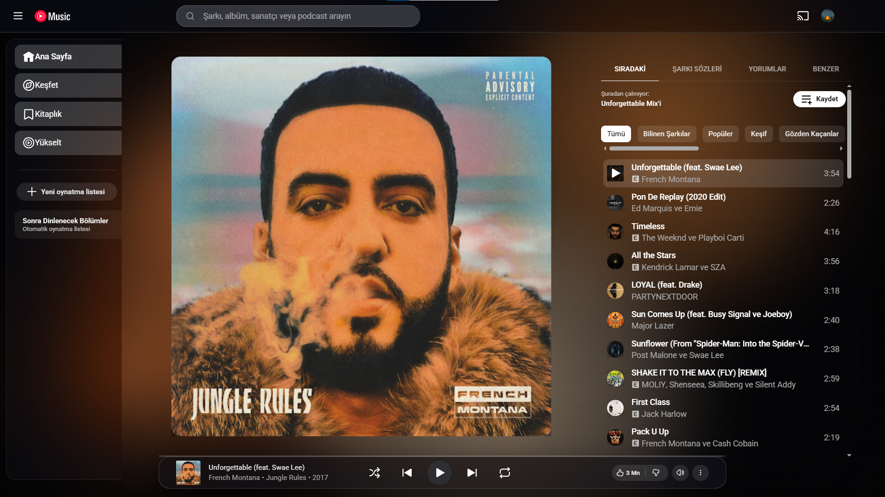

# YouTube Music SFX - Audio Reactive Background & Glassmorphic UI

A Chromium browser extension (Manifest V3) that brings an audio-reactive visualizer background and a modern frosted glass (glassmorphism) interface to YouTube Music.



[](#)
[](#)
[](#)
[](LICENSE)

---

## Features

- **Real-Time Audio Analysis:** Connects to the YouTube Music audio stream using the Web Audio API (`AnalyserNode`) to analyze bass, mid, and treble frequencies in real time.
- **Dynamic Color Extraction:** Automatically samples dominant colors from the current album artwork and adapts the background lighting to match the playing track.
- **Glassmorphic Interface:**
  - Frosted glass top navigation bar and left sidebar drawer.
  - Floating player bar island at the bottom.
  - Borderless, soft-shadow album artwork presentation on the player page.
- **Clean Separation:** The visualizer activates exclusively on the full-screen player page. The home and browse feeds remain completely native and unobstructed.
- **Multiple Visualizer Modes:**
  - **Aurora:** Organic flowing light blobs responding to bass and rhythm.
  - **Bass Pulse:** Concentric energy pulses radiating on low-frequency beats.
  - **Frequency Waves:** Dynamic neon frequency curves across the screen.
  - **Cosmic Particles:** Floating particles that accelerate and glow with the audio spectrum.
- **Popup Control Panel:** Easily customize sensitivity, background opacity, blur radius, and animation speed on the fly.

---

## Installation

1. Clone or download this repository:
   ```bash
   git clone https://github.com/swumutcan/YoutubeMCSFX.git
   ```
2. Open your browser and navigate to the extensions page:
   - **Google Chrome:** `chrome://extensions`
   - **Microsoft Edge:** `edge://extensions`
   - **Brave:** `brave://extensions`
3. Enable **Developer mode** (toggle in the top-right corner).
4. Click **Load unpacked** (top-left button).
5. Select the `YoutubeMCSFX` project directory.
6. Open [music.youtube.com](https://music.youtube.com) and start playing music.

---

## Settings & Controls

Click the extension icon in your browser toolbar to adjust settings:

| Setting | Default | Description |
| :--- | :--- | :--- |
| **Visualizer Mode** | `Aurora` | Select from Aurora, Bass Pulse, Frequency Waves, or Particles. |
| **Color Theme** | `Album Artwork` | Dynamic album colors or preset color palettes. |
| **Sensitivity** | `1.2x` | Controls visual reaction intensity to audio frequencies. |
| **Brightness / Opacity** | `75%` | Background lighting opacity level. |
| **Blur Radius** | `40px` | Softness and diffusion of the light aura. |
| **Speed** | `1.0x` | Base animation transition speed. |

---

## License

This project is licensed under the [MIT License](LICENSE).
