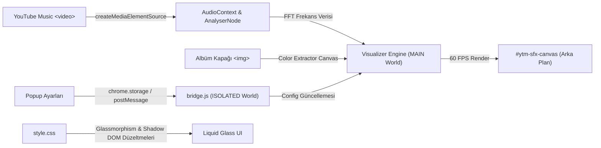

# 🎵 YouTube Music SFX - Audio Reactive Background & Liquid Glass UI

<p align="center">
  
</p>

<p align="center">
  <b>YouTube Music deneyimini ses dalgalarına duyarlı dinamik aura arka planı ve modern sıvı cam (Liquid Glass) arayüzü ile yeniden tanımlayın.</b>
</p>

<p align="center">
  
  
  
  
</p>

---

## ✨ Özellikler

- 🎶 **Gerçek Zamanlı Web Audio Analizi:** Müziğin bas (bass), orta (mid) ve tiz (treble) frekanslarını `Web Audio API` (FFT) ile sıfır gecikmeyle analiz eder.
- 🎨 **Dinamik Albüm Rengi Senkronizasyonu (ColorSync):** Çalan şarkının albüm kapağındaki baskın renkleri otomatik olarak çıkarır ve arka plan ambiyansını bu tonlara göre uyarlar.
- 🪟 **Liquid Glass (Buzlu Cam) Arayüzü:** 
  - Üst gezinme çubuğu ve sol menü paneli akıcı cam efektiyle arka plandaki ışık şovunu yansıtır.
  - Altta yüzen, modern ada (floating island) tarzı oynatıcı çubuğu.
  - Oynatıcı sayfasında çerçevesiz, yumuşak gölgeli ve yuvarlatılmış albüm kapağı.
- 🏠 **Doğal Ana Sayfa Koruma Mekanizması:** Ana sayfa ve göz atma bölümlerinde YouTube Music'in tüm yerel kartları, listeleri ve metinleri %100 orijinal kalır; görsel efekt yalnızca tam ekran müzik oynatıcı açıldığında devreye girer.
- 🎛️ **4 Farklı Efekt Modu:**
  1. **Aurora & Sıvı Işık (Önerilen):** Akıcı, ritme göre kabaran organik ışık küreleri.
  2. **Bass Pulse:** Güçlü vuruşlarda merkezden dışa yayılan enerji halkaları.
  3. **Frekans Dalgaları:** Ekran boyunca ritmik dalgalanan neon şeritler.
  4. **Kozmik Parçacıklar:** Bas vuruşlarında hızlanan ve parlayan parçacıklar.
- ⚙️ **Popup Kontrol Paneli:** Hassasiyet, bulanıklık, opaklık ve hız değerlerini canlı olarak ayarlayabileceğiniz modern açılır panel.
- ⚡ **Yüksek Performans & Düşük Kaynak Tüketimi:** Donanım hızlandırmalı HTML5 Canvas ve CSS bulanıklık optimizasyonu sayesinde %1'in altında CPU/GPU tüketimi ile 60 FPS akıcılık.

---

## 🚀 Kurulum (Adım Adım)

Bu eklenti açık kaynaklı bir Chrome Manifest V3 eklentisidir. **Google Chrome**, **Microsoft Edge**, **Brave** veya **Opera** üzerinde kolayca çalıştırabilirsiniz:

1. Bu projeyi bilgisayarınıza indirin veya klonlayın:
   ```bash
   git clone https://github.com/swumutcan/YoutubeMCSFX.git
   ```
2. Tarayıcınızın eklentiler sayfasına gidin:
   - **Google Chrome:** `chrome://extensions`
   - **Microsoft Edge:** `edge://extensions`
   - **Brave:** `brave://extensions`
3. Sağ üst köşedeki **"Geliştirici modu" (Developer mode)** anahtarını açın.
4. Sol üstte beliren **"Paketlenmemiş öğe yükle" (Load unpacked)** butonuna tıklayın.
5. Projenin bulunduğu klasörü seçin (`YoutubeMCSFX`).
6. [music.youtube.com](https://music.youtube.com) adresine gidin ve favori parçanızı başlatın!

---

## 🛠️ Mimari & Nasıl Çalışır?



- **`content/visualizer.js` (MAIN World):** Sayfa kontekstinde doğrudan çalışarak YouTube Music oynatıcısındaki `<video>` etiketine bağlanır. FFT (Fast Fourier Transform) ile ses verisini yakalar, albüm kapağının renk paletini çıkarır ve donanım hızlandırmalı canvas'a 60 FPS hızla çizer.
- **`content/bridge.js` (ISOLATED World):** Chrome Extension API (`chrome.storage`, `chrome.runtime`) ile ana sayfa konteksti arasındaki iletişimi güvenli bir `window.postMessage` köprüsüyle sağlar.
- **`content/style.css`:** YouTube Music'in opak siyah arayüz bloklarını `backdrop-filter: blur(...)` destekli modern buzlu cam görünümüne dönüştürür ve Polymer Web Components (Shadow DOM) içerisindeki istenmeyen yatay kaydırma çubuklarını temizler.
- **`popup/`:** Kullanıcının hassasiyet, renk modu ve efekt türünü canlı olarak değiştirebildiği modern kontrol arayüzü.

---

## 🎛️ Popup Kontrol Seçenekleri

| Ayar | Varsayılan | Açıklama |
| :--- | :--- | :--- |
| **Görsel Efekt Modu** | `Aurora` | Arka planda çalışacak görsel algoritma (Aurora, Pulse, Wave, Particles). |
| **Renk Teması** | `Albüm Kapağı` | Dinamik albüm rengi veya Cyberpunk, Synthwave gibi özel paletler. |
| **Ritim & Bas Hassasiyeti** | `1.2x` | Ses analizinin görsel reaksiyon şiddeti. |
| **Arka Plan Parlaklığı** | `75%` | Arka plan ışık efektinin opaklığı. |
| **Bulanıklık (Blur)** | `40px` | Arka plan ışıklarının yayılma ve yumuşaklık derecesi. |
| **Akış Hızı** | `1.0x` | Efekt animasyonlarının geçiş hızı. |

---

## 📄 Lisans

Bu proje [MIT Lisansı](LICENSE) kapsamında açık kaynak olarak yayınlanmıştır. Dilediğiniz gibi geliştirebilir, değiştirebilir ve paylaşabilirsiniz.
